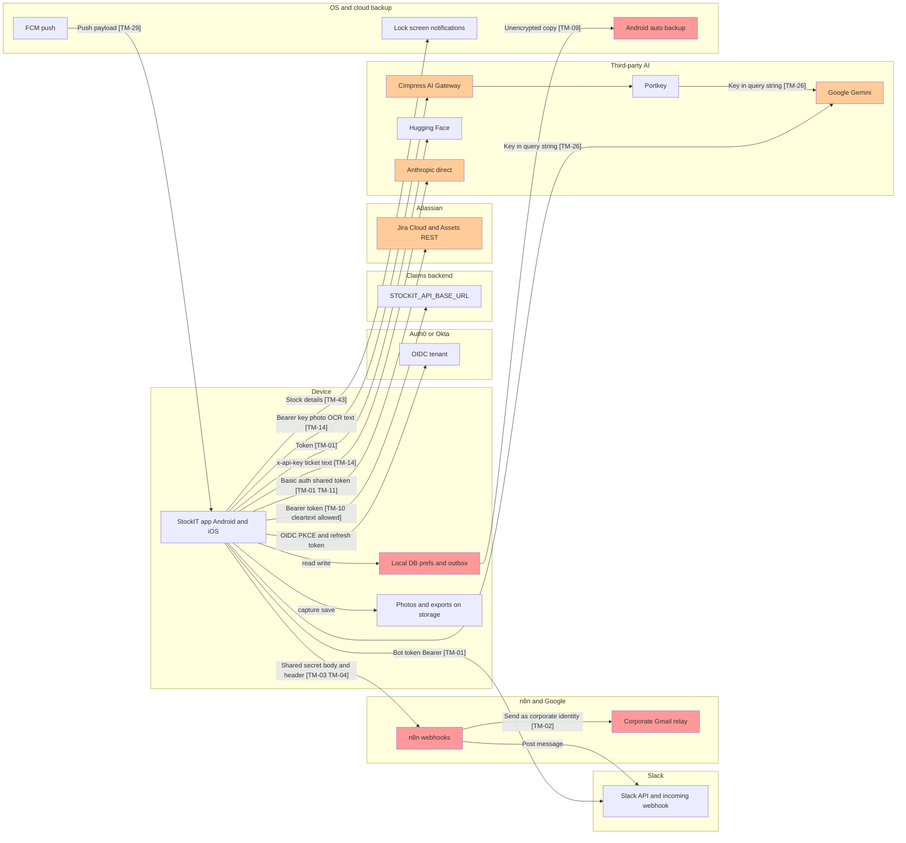
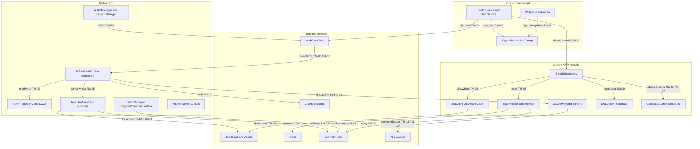
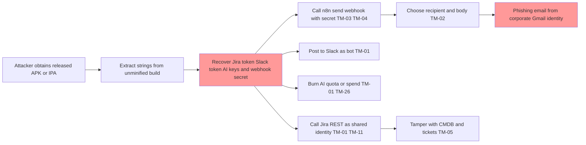
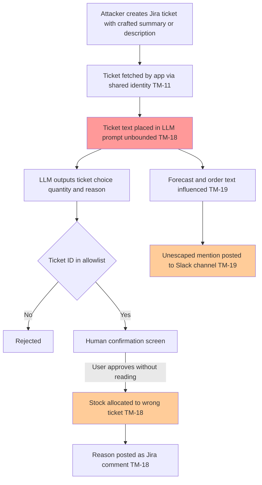
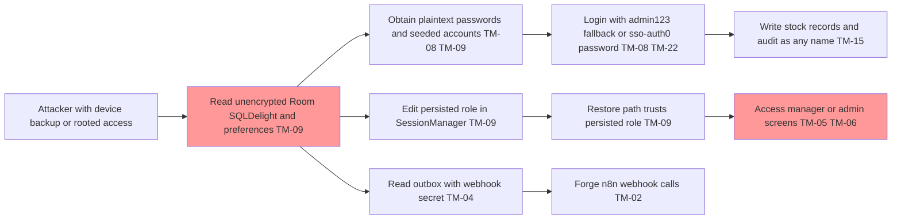
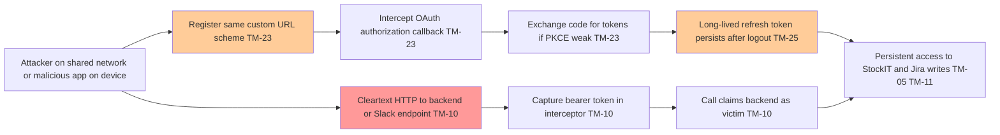

# StockIT — Threat Model

| Field | Value |
|---|---|
| Date | 2026-10-28 |
| Version | 1.0 |
| Method | STRIDE (Spoofing, Tampering, Repudiation, Information disclosure, Denial of service, Elevation of privilege) |
| Scope (in) | Repository contents: Android app (Java 11, Room, Retrofit/OkHttp, WorkManager, ML Kit, CameraX, iText PDF, Auth0 SDK), Kotlin Multiplatform shared module (Ktor, SQLDelight) compiled to an iOS framework, SwiftUI iOS 16 app and WidgetKit extension (App Group `group.com.ETX.stockit`), n8n workflow JSON files in the repository |
| Scope (out) | n8n server runtime, claims backend, Auth0/Okta tenant configuration, Jira and Slack tenants, Google Workspace configuration, CI/CD infrastructure (none in repo) |
| Status | Findings were verified by four analysts; this document consolidates and deduplicates them. Items not verified are listed in section 9. |
| Secrets policy | No secret values are reproduced in this document. Local secret-bearing files were not read. |

### Change log

| Date | Version | Change |
|---|---|---|
| 2026-10-28 | 1.0 | Initial threat model created |

---

## Executive Summary

StockIT is a mobile inventory and IT-asset management client (French and English UI) that talks **directly from the device** to Jira Cloud, Jira Assets, Slack, n8n webhooks, several AI providers, and an optional claims backend. The dominant architectural weakness is that the **app is the trust boundary**: third-party credentials are compiled into the binary, authorization is decided on the client, and webhook calls are protected only by a static shared secret. Anyone who obtains a released APK or IPA can extract the keys, and the same keys are what let the app write to Jira and send email.

### Top 5 critical and high risks

| Rank | ID | Risk | Residual |
|---|---|---|---|
| 1 | TM-01 | Third-party credentials (Jira, Slack, AI, webhook secret) compiled into APK/IPA; minification disabled | Critical |
| 2 | TM-02 | n8n send workflow acts as an open mail relay from the corporate Gmail identity (phishing, spoofing) | Critical |
| 3 | TM-05 | Authorization is client-side only; privileged writes use the embedded shared identity | High |
| 4 | TM-06 | Role mapping uses substring matching, first match wins (privilege escalation via group or role names) | High |
| 5 | TM-08 | Hardcoded `admin/admin123` fallback and seeded accounts; iOS seeding runs in release builds | High |

Honourable mentions (High): TM-03/TM-04 (webhook secret may fail open, no replay protection), TM-09 (plaintext passwords and unencrypted databases with backup enabled), TM-10 (cleartext HTTP allowed with bearer interceptor and no host allowlist).

### Prioritized remediation roadmap

**Immediate (0 to 2 weeks)**
1. Rotate every key that has ever been shipped in an APK/IPA or local build: Jira API token, Slack bot token, Cimpress gateway key, Gemini key, Portkey key, Hugging Face token, SendGrid key (TM-01), and the n8n shared webhook secret (TM-03, TM-04).
2. Add a server-side recipient allowlist, rate limit and body-size limit to `n8n/stockit-send-workflow.json`; disable the `$env.STOCKIT_DEFAULT_EMAIL` fallback for ad-hoc recipients (TM-02).
3. Make the n8n secret check fail closed when the environment variable is empty; stop the client sending a blank secret (TM-03).
4. Remove the `admin/admin123` fallback and the iOS seeding path from release builds; gate all seeded accounts behind debug-only code (TM-08).
5. Set `isMinifyEnabled = true` and remove debug/admin credentials from UI and live tests (TM-16, TM-38).

**Short-term (2 to 6 weeks)**
1. Introduce a backend-for-frontend (BFF) or proxy that validates the Auth0 access token and holds all third-party credentials; move Jira to per-user OAuth 3LO (TM-01, TM-05, TM-11, TM-27).
2. Enforce roles on the server and replace substring matching with exact claim matching on `sub` and group IDs; set the SSO default role to the least-privileged value and fail closed for unknown groups (TM-05, TM-06, TM-07, TM-22).
3. Sign webhook requests (HMAC over body plus timestamp and nonce) and make outbox replay idempotent with an event ID (TM-04, TM-21).
4. Enforce HTTPS only (remove `usesCleartextTraffic`, add a network security config and host allowlist for bearer tokens), and validate ID tokens on iOS (TM-10, TM-24).
5. Encrypt local databases (SQLCipher or equivalent), stop storing passwords in plaintext, disable `allowBackup` or define real backup and extraction rules (TM-09).
6. Stop sending raw photos and PII to third-party AI by default; redact and minimise before any model call (TM-14).

**Medium-term (6 to 16 weeks)**
1. Build a server-side audit log with authenticated actor identity and append-only storage; remove the hardcoded `127.0.0.1` IP (TM-15).
2. Replace destructive Room migrations and add explicit SQLDelight migrations with schema export (TM-13).
3. Pin dependencies (`auth0` to an exact version), add Gradle dependency verification and a lockfile, remove JitPack, and add CI with SAST, SCA and secret scanning (TM-31, TM-32).
4. Add prompt-injection defences for ticket and invoice text, escape Slack mentions, and require human confirmation for every model-driven write (TM-18, TM-19).
5. Remove sensitive values from logs and CSV exports, neutralize CSV formula injection, and apply retention rules to photos and exports (TM-28, TM-34, TM-36).

---

## 1. Project Overview

### 1.1 Purpose
StockIT lets field and warehouse staff track IT equipment stock, receive packages and delivery notes (OCR and LLM parsing), check out assets against Jira service tickets, sync asset records with Jira Assets, and send notifications to Slack and email through n8n. It also produces forecast and order-draft suggestions with AI assistance.

### 1.2 Tech stack

| Layer | Technologies |
|---|---|
| Android | Java 11, Room, Retrofit and OkHttp, WorkManager, ML Kit, CameraX, iText PDF, Auth0 Android SDK `3.+`, Firebase Messaging (plugin commented out) |
| Shared | Kotlin Multiplatform, Ktor, SQLDelight, compiled to an iOS framework |
| iOS | SwiftUI, iOS 16 minimum, WidgetKit, App Group `group.com.ETX.stockit` |
| Automation | n8n workflow JSON (send, event, asset-status, slack) |
| Identity | Auth0 or Okta SSO, scopes `openid profile email offline_access` |

### 1.3 Architecture summary
- Android and iOS clients hold the business logic for stock, tickets and AI parsing. The shared KMP module provides parts of the same logic to iOS.
- The client calls Jira Cloud REST and Jira Assets directly using Basic auth with a shared email and API token.
- Slack is reached three ways: bot token `chat.postMessage`, incoming webhook, or the n8n relay.
- n8n webhooks (`/webhook/stockit/send`, `event`, `asset-status`, `slack`) are called from the device with a shared secret in the body and in the `X-App-Secret` header.
- AI calls go to the Cimpress AI Gateway (Bearer), Anthropic directly (`x-api-key`), Portkey, Google Gemini (key in the query string), and Hugging Face.
- An optional claims backend (`STOCKIT_API_BASE_URL`, default `http://10.0.2.2/api/`) is called with the Auth0 bearer token.
- There is no backend, CI pipeline or infrastructure-as-code in the repository. Release builds are produced locally, unsigned, with minification disabled.

### 1.4 Trust boundaries
1. **Device boundary**: everything on the handset is attacker-readable once the APK or IPA is obtained. Includes local database, preferences, outbox, photos and exports.
2. **Identity boundary**: Auth0 or Okta issues tokens; the client trusts the role it derives from them.
3. **Third-party boundary**: Jira, Slack, AI providers, Google, and n8n each receive data and credentials directly from the device.
4. **n8n boundary**: n8n trusts any request carrying the shared secret; it then acts with the corporate Gmail and Slack identities.
5. **Backend boundary** (claims API): assumed to enforce authorization; not in scope for verification.
6. **OS boundary**: Android auto-backup, FCM, lock-screen notifications, iOS task switcher, widget data in the App Group.

### 1.5 Key assumptions
- Attackers may obtain any released binary and can run it on a device they control.
- Corporate Jira, Slack and Gmail identities are high-value and shared across users.
- The released builds were produced with the default or documented configuration; which configuration was used is unverified (see section 9).
- Backend and n8n server-side enforcement is not visible in this repository and is treated as unknown.

---

## 2. Asset Identification

| Asset Name | Type | Sensitivity Level | Description |
|---|---|---|---|
| Jira API token and shared Jira email | Credential | Critical | Compiled into app via buildConfigField. `app/build.gradle.kts:53-75`. Also in `shared/build.gradle.kts:27-37,58-84` |
| Slack bot token | Credential | Critical | `app/build.gradle.kts:53-75`; `StockItConfig.kt:11-50` |
| Cimpress AI gateway key, Gemini key, Portkey key, Hugging Face token, Anthropic key | Credential | Critical | `app/build.gradle.kts:53-75`; `shared/build.gradle.kts:58-84` (GeneratedConfig, including `CLAUDE_API_KEY`); `StockItConfig.kt:11-50` |
| n8n webhook shared secret (`STOCKIT_WEBHOOK_SECRET`) | Credential | High | Sent in request body and `X-App-Secret` header. `StockItReporter.kt:86-90,101-109`; `WebhookOutbox.java:73-74,89` |
| SendGrid key (unused) | Credential | Low (unused but shipped) | `app/build.gradle.kts:56`; see TM-40 |
| Auth0 access, ID and refresh tokens | Credential | Critical | Stored via Auth0 `SecureCredentialsManager` (Keystore) `Auth0Manager.java:67-70`; iOS Keychain `AuthService.swift:13-14`. Refresh token survives logout (TM-25) |
| Local user table and plaintext passwords | Personal data and credential | High | Room `User.java:11`, `UserDao.java:12`; SQLDelight `User.sq:4,12,16`; seeded accounts `StockItRepository.kt:80-84,127-137,143-146` |
| Local Room database (`AppDatabase.java`) | Data store | High | Unencrypted, `allowBackup=true` (`AndroidManifest.xml:19`), `AppDatabase.java:26-29` |
| SQLDelight database (iOS and KMP) | Data store | High | Unencrypted; `StockItRepository.kt` |
| Session preferences (`SessionManager.java`) | Data store | High | Role and identity in plaintext preferences `SessionManager.java:15-19,52-59` |
| Webhook outbox | Data store | High | Stores secret and PII, `WebhookOutbox.java:40,74,89,143-144`; `StockItRepository.kt:1266,1278` |
| Stock, asset and movement records | Business data | Medium to High | Room and SQLDelight; mutable, client-asserted actor; `MainController.java:672-681` (recordMovement, unaudited) |
| Audit trail | Business and compliance data | High | Local-only, editable, wiped by destructive migration (TM-15, TM-13) |
| Jira tickets, CMDB (Jira Assets) objects | Business data | High | Jira REST `JiraClient.kt:41,82-95,146-172`; Assets `JiraAssetsClient.kt:118-119,244-406` |
| Corporate Gmail identity | Identity | Critical | Used by n8n to send email; `n8n/stockit-send-workflow.json:52,81` |
| Corporate Slack identity and channels | Identity | High | Bot token and n8n relay; `SlackNotifier.kt:25-28,68-84` |
| Employee PII (names, emails, usernames, roles) | Personal data | High | Logged `MainController.java:252,317`; sent to AI and n8n |
| Delivery note, invoice and package photos (raw bytes, EXIF and GPS) | Personal and business data | High | Sent to AI gateways `AIGateway.kt:186-217`; retained on external storage `MainActivity.java:424,1112-1126`; `ImageOptimizerUtil.java:68` |
| Inventory CSV and PDF reports | Business data | Medium | Daily CSV to n8n `StockItApp.java:43-52`, `ReportWorker.java:30-72`; PDF `PdfReportGenerator.java:61` |
| AI chat history | Business data | Medium | `AIChatActivity.java:18,49-50,74` |
| Widget and lock-screen data | Business data | Low to Medium | `StockWidget.java:37-63`; `StockITWidget.swift:13-17`; `NotificationHelper.java:24-29` |
| Build pipeline and signing material | Integrity asset | High | Local unsigned release (`EXECUTION_REPORT.md`); no signing config; no CI in repo |
| Gradle, SPM and Maven dependency graph | Integrity asset | Medium | `app/build.gradle.kts:175` (`auth0:3.+`); JitPack `settings.gradle.kts:22`; `Package.resolved` pinned |

---

## 3. Threats & Controls

Severity legend: Critical, High, Medium, Low describe **residual** risk after the existing controls listed. Rows marked with ⚠️ have no effective control and need immediate attention.

Likelihood scale: H (high), M (medium), L (low). Residual counts are in the Risk heat summary.

### 3.1 Domain-specific threats (mobile app / integrations / AI)

| ID | Threat Name | STRIDE Category | Description | Potential Impact | Likelihood | Existing Controls | Residual Risk | Recommended Mitigation |
|---|---|---|---|---|---|---|---|---|
| TM-01 | ⚠️ Third-party credentials compiled into APK/IPA | Information disclosure, Elevation of privilege | Jira, Slack, AI, Gemini, Portkey, Hugging Face, SendGrid and webhook secret are embedded at build time; minification off so strings remain readable. Anyone with the binary can extract them | Full misuse of Jira, Slack, AI and n8n under the shared identity; cost abuse; data exfiltration | H | None effective. Secrets are gitignored and absent from git history, but the shipped binary contains them | Critical | ⚠️ No effective control: BFF or proxy holding keys and validating Auth0 token; remove keys from client; rotate every shipped key; per-user Jira OAuth 3LO |
| TM-02 | ⚠️ n8n send workflow is an open mail relay | Spoofing, Elevation of privilege, Repudiation | Recipient is taken from request body with fallback to default env address; subject and body come from request; sent from corporate Gmail | Phishing from a trusted domain; reputational and compliance damage; no attribution | H | Shared-secret IF check (body only), 403 response | Critical | ⚠️ No effective control: server-side recipient allowlist; fixed templates; HMAC and header auth; rate limit; size limits; per-user audit |
| TM-03 | ⚠️ Webhook secret check may fail open | Spoofing | Check runs against body only; if env var empty the comparison can pass; client sends a blank secret unconditionally | Anyone can call webhooks without the secret | M | Shared secret exists (but may be empty) | High | ⚠️ Fail closed when env empty; require header and body match; do not send empty secret |
| TM-04 | ⚠️ No integrity or replay protection on webhooks | Tampering, Spoofing | Static secret with no HMAC, timestamp or nonce; the same payload can be replayed indefinitely | Replayed or forged events trigger Slack, email and Jira actions | H | None beyond static secret | High | ⚠️ HMAC-SHA256 over body with timestamp and nonce; reject stale requests; server-side replay cache |
| TM-05 | ⚠️ Client-side-only authorization; privileged writes use embedded identity | Elevation of privilege | Role checks live in the app; Jira writes use the shared identity directly, so any user (or attacker with a modified client) can write to CMDB and tickets | Unauthorized stock changes, asset checkout, ticket creation | H | Role checks in UI only; some flows gated by manager approval | High | ⚠️ Enforce authorization on the server or BFF; per-user identity to Jira; remove direct writes from client |
| TM-06 | ⚠️ Substring role matching; first match wins | Elevation of privilege | Role derived by `contains("ADMIN")`, `"MANAGER"`, `"TECH"` on group or role names; first match wins | A group such as "NOT_ADMIN" or "ADMINISTRATIVE_ASSISTANT" grants ADMIN | M | None | High | ⚠️ Exact match on group IDs; deny-by-default mapping; server-side role source |
| TM-07 | SSO default role misconfiguration (fail-open) | Elevation of privilege | Unknown groups receive the default role. Code default is USER but the local configuration sets MANAGER; release configuration unverified | Unintended manager-level access for all SSO users | M | Code default USER (`StockItConfig.kt:61`); checklist documents USER | High (depends on configuration used for release) | Set default to least-privilege USER; fail closed on unknown groups; add build-time check that default role is USER |
| TM-08 | ⚠️ Hardcoded admin credential and seeded accounts; iOS seeding in release | Spoofing, Elevation of privilege | `admin/admin123` fallback; seeded accounts with `pass123`; `INSERT OR REPLACE` resets roles and passwords on every start; iOS seeding runs outside `#if DEBUG` | Local admin login on devices; silent role reset | H | Android local login UI debug-only (`LoginActivity.java:74-78`); iOS UI gated (`AuthViews.swift:54-56`) but seeding is not | High | ⚠️ Remove fallback and seeds from release; move to debug-only source set; use `INSERT OR IGNORE` or explicit migration; wrap iOS seeding in `#if DEBUG` |
| TM-09 | ⚠️ Plaintext passwords and unencrypted local stores with backup enabled | Information disclosure, Tampering | Passwords stored in plaintext; Room and SQLDelight databases unencrypted; preferences unencrypted; `allowBackup=true` with backup and extraction rules fully commented out and not referenced; outbox stores secret and PII. Restore path trusts persisted role | Credential and PII exposure via backup, rooted device or extraction; role tampering on restore | M | Keystore-backed Auth0 tokens only; device-level file encryption | High | ⚠️ Hash or drop local passwords; SQLCipher; encrypted preferences; `allowBackup=false` or explicit rules excluding DB and prefs; re-derive role from server on restore |
| TM-10 | ⚠️ Cleartext HTTP allowed with bearer interceptor and no host allowlist | Information disclosure, Spoofing | `usesCleartextTraffic=true`; bearer token attached to any configured base URL; Slack client accepts `http://`; no certificate pinning; no network security config | Token and data interception on hostile networks; token theft | M | iOS ATS enforced (only local networking exception); timeouts on clients | High | ⚠️ Remove cleartext; network security config; host allowlist in interceptor; reject `http://` in Slack and API URLs; consider pinning for backend |
| TM-11 | Shared Jira identity blast radius | Elevation of privilege, Tampering | One Jira email and API token used by all users; no per-user attribution; any client can modify CMDB and tickets | Tampering on asset records; no accountability; wide impact if token leaks (see TM-01) | H | Ticket allowlist for LLM-selected tickets (see TM-18) | High | Per-user Jira OAuth 3LO; least-privilege project scope; separate service account with minimal permissions |
| TM-12 | Wrong PO marked as received via digit-only match | Tampering, Repudiation | OCR or LLM PO number matched to database ID by digits only; wrong package marked "Reçu", triggering Slack, email and Jira | Incorrect stock records; misdirected notifications | M | Human review screens in iOS (`ScanViews.swift:431,512`) | High | Exact PO match with full key; require confirmation with both values shown; reject ambiguous matches |
| TM-13 | Destructive Room migration causes data loss | Denial of service, Tampering | `fallbackToDestructiveMigration` on v22 with `exportSchema=false`; no SQLDelight `.sqm` migrations | Loss of stock and audit history on app update | M | None | Medium | Explicit Room migrations; export schema; SQLDelight migration files; backup before migration |
| TM-14 | PII and photos sent to third-party AI | Information disclosure (privacy, GDPR) | Photos (raw bytes with EXIF and GPS) and invoice OCR text sent through a provider cascade (Cimpress, Portkey, Gemini, Hugging Face); ticket text to Claude. A code comment in `Insights.kt:188` contradicts the behaviour at lines 197-199 | Personal data disclosed to multiple processors; regulatory exposure | H | Some downscaling (`ImageBytes.java:23-31`, `VisionService.swift:39-53`) | High | Strip EXIF; minimise and redact before model calls; contract and DPA review per provider; opt-out default; fix misleading comment |
| TM-15 | Weak and local-only audit trail | Repudiation | Hardcoded IP `127.0.0.1` in audit records (`MainController.java:301`, `StockItRepository.kt:1301`, `AssetsSync.kt:325`); client-asserted actor; editable; wiped by destructive migration; movements unaudited (`MainController.java:672-681`); outbox drops over 200 items (`WebhookOutbox.java:146`) and attempts at 20 silently (`Outbox.sq:15,24`) | Actions cannot be attributed or reconstructed | H | None effective | High | Server-side append-only audit with authenticated actor; include request ID; alert on dropped events |
| TM-16 | ⚠️ Release hardening missing | Tampering, Information disclosure | No R8 (`app/build.gradle.kts:106-108`); `proguard-rules.pro` empty; no `signingConfigs`; `EXECUTION_REPORT.md` documents an unsigned `app-release-unsigned.apk` | Easy reverse engineering; unsigned or tamperable artefacts distributed | H | Gitignore for build outputs | High | ⚠️ Enable R8 and resource shrinking; sign with managed key; use Play App Signing or equivalent; build in CI |
| TM-17 | Test mode writes fake success and stores real keys | Repudiation, Tampering | User-toggled local test flag with no role check; returns fake success; `TEST-####` Jira keys stored as real (`JiraClient.kt:49`, `JiraClient.java:63`); events dropped unaudited (`WebhookOutbox.java:56`); "Tester Slack" ignores test mode (`SlackNotifier.kt:54-59`; `SettingsActivity.java:71-108`; `MoreViews.swift:86-118`; `SharedBridge.kt:56,76-82`; `StockITApp.swift:20`) | Data integrity confusion; spurious production records; unaudited behaviour | M | Test mode suppresses outbound writes in the main path | Medium | Restrict test mode to debug builds; enforce role; prefix or segregate test records; audit every test-mode action |
| TM-18 | Prompt injection via Jira ticket text | Tampering, Elevation of privilege | Ticket summary (unbounded, `Parsers.kt:68`), description (400 chars, `:71`) and LLM-produced reason (uncapped, `:102,107`) reach the LLM; LLM selects ticket and quantity; reason posted as Jira comment (`StockItRepository.kt:641-644`; `SharedBridge.kt:205-208`; `TicketMatcher.java:129-181`) | Wrong ticket updated; forged comments; wrong stock allocation | M | Ticket ID allowlist (`ScanOutActivity.java:392-404`); human confirm (`:432-503`); quantity caps (`Parsers.kt:99-109`); iOS review (`TicketViews.swift:212,335`) | Medium | Cap all fields; strip control and instruction-like text; structured output with schema validation; require human confirmation for every write |
| TM-19 | Prompt injection into forecasts, orders and Slack | Tampering, Information disclosure | Injected text influences forecast and order drafts (`Insights.kt:168-169,197-220`; `StockItRepository.kt:1047-1057,1083,1105-1108`; `ProductMatcher.kt:92-96`); unescaped text in Slack allows `<!channel>` mentions (`SlackNotifier.kt:40,99`; `MainController.java:1203-1217`) | Spam to channels; misleading orders | M | Manager approval (`StockItRepository.kt:1091-1092`); truncation | Medium | Escape Slack control sequences; restrict mentions via `allowed_mentions` equivalent; bound outputs; validate against numeric limits |
| TM-20 | Two-way Jira Assets sync conflicts | Tampering, Data integrity | Jira overwrites local values; local-only rows with qty above 0 pushed as new CMDB units; duplicates merged by summing (`AssetsSync.kt:138-150,178-194`; `StockItRepository.kt:403-510`) | Inventory counts inflated or lost | M | 50-unit cap (`JiraAssetsClient.kt:49`) | Medium | Single source of truth per field; conflict detection with version; dry-run before push; idempotent keys |
| TM-21 | Outbox replay is non-idempotent | Tampering, Repudiation | No event ID; success detected by string match on `"ok":false` (`StockItReporter.kt:108`; `WebhookOutbox.java:115`; replay loop `StockItRepository.kt:1285-1294`) | Duplicate emails, Slack posts and Jira actions | M | Outbox caps | Medium | Event IDs and server-side dedupe; parse JSON response, not substring |
| TM-22 | Identity keyed on mutable nickname or name | Spoofing | SSO user can take over a local row with the same name (`Auth0Manager.java:345-349`; `AuthService.swift:56-57`; `MainController.java:321-337`; `StockItRepository.kt:95-103`); SSO rows use literal password `sso-auth0` usable at local login (debug-gated; `MainController.java:268,337,362`; `StockItRepository.kt:81,103,116`) | Account takeover of a local user by SSO identity with same name | M | Local login debug-only | Medium | Key on Auth0 `sub`; never store static passwords for SSO rows; unique constraint on identity |
| TM-23 | Custom URL scheme OAuth callback hijack | Spoofing | Custom scheme `com.example.stockit` (`strings.xml:12`) and generic `stockit` scheme (`Info.plist:36-47`); no App Links or Universal Links; PKCE assumed from SDK (unverified) | A malicious app can intercept authorization codes | M | Ephemeral iOS auth session (`AuthService.swift:45`); `prompt=login` (`Auth0Manager.java:241-244`) | Medium | Verified App Links and Universal Links; confirm PKCE and state; remove generic scheme |
| TM-24 | iOS ID token decoded without validation | Spoofing, Tampering | Token payload decoded for role without verifying signature, `iss`, `aud`, `exp` or nonce (`AuthService.swift:54-65,82-90`) | Forged claims set role on iOS | L | Token obtained over TLS from Auth0 SDK flow | Medium | Verify signature and claims with Auth0 SDK or JWKS; derive role server-side |
| TM-25 | Logout and background lock do not revoke refresh token | Spoofing, Information disclosure | Logout and lock clear local state only (`AuthService.swift:75-80`; `Auth0Manager.java:288-309`; `AppState.swift:39-47`; `AppSession.kt:79-91`) | Persistent access after device handover | M | Session wiped on cold start (`SplashActivity.java:37-38`) | Medium | Revoke refresh tokens on logout; shorter refresh lifetime; re-authenticate for sensitive actions |
| TM-26 | Gemini key in URL query and reuse as Portkey key | Information disclosure | Key sent as `?key=` in URLs (`AIGateway.kt:156,305`; `GeminiGatewayClient.java:298`; `AIService.java:36`); Gemini key reused as Portkey virtual key sent to `api.portkey.ai` (`GeminiGatewayClient.java:85-86,222-224`) | Key leakage through proxies, logs and history; cross-provider misuse | M | HTTPS | Medium | Use headers only; separate keys per provider; move to BFF |
| TM-27 | Configurable base URLs carry credentials without allowlist | Information disclosure, Spoofing | Base URLs from config or Info.plist overrides (`JiraClient.kt:43`; `JiraAssetsClient.kt:123`; `AIGateway.kt:87,199`; `StockItApi.kt:28-31`; `JiraClient.java:104`; `AppConfig.swift:7-11`) can redirect credentials | Credential exfiltration by config tampering | M | Config from build inputs | Medium | Allowlist hosts per credential; lock overrides in release builds |
| TM-29 | FCM push echoed into n8n email | Information disclosure, Repudiation | Push payload forwarded to `STOCKIT_DEFAULT_EMAIL` via n8n (`MyFirebaseMessagingService.java:12-25`); FCM plugin commented out (`app/build.gradle.kts:3`), so behaviour unverified | Push content leaked by email; unverified path | L | None | Medium | Remove forwarding; confirm FCM status; never email raw push content |
| TM-30 | Daily inventory CSV sent to n8n regardless of session | Information disclosure | Full inventory CSV built in memory and posted every day, not conditioned on login (`StockItApp.java:43-52`; `ReportWorker.java:30-72`) | Bulk business data to Gmail and Slack via n8n; memory pressure | M | Shared-secret check (see TM-03) | Medium | Gate on authenticated session; send summaries not full data; server-side recipient controls |
| TM-33 | No FLAG_SECURE or privacy overlay | Information disclosure | Sensitive screens can be captured by task switcher and screenshots | Screenshots of stock, PII or tickets | M | None | Medium | `FLAG_SECURE` on sensitive Android screens; privacy overlay on iOS when backgrounded |
| TM-34 | CSV formula injection and CSV corruption | Tampering | Unescaped cell values in exports (`MainController.java:633-637`; `StockItRepository.kt:767-774`; `ReportWorker.java:34-40`) | Spreadsheet formula execution when opened; corrupted columns | M | None | Medium | Prefix formula characters (`=`, `+`, `-`, `@`); RFC 4180 quoting |
| TM-35 | Resource exhaustion via images, OCR and chat | Denial of service | Full-resolution decodes (`ImageOptimizerUtil.java:36`; `MainController.java:1235-1241`; `ReceivePackageActivity.java:313`); uncapped OCR text to LLM (`Parsers.kt:150`; `DeliveryNoteParser.java:141`; `PackageLabelParser.java:216`); unbounded chat history (`AIChatActivity.java:18,49-50,74`) | Out of memory crashes; large AI bills | M | Downscale in `ImageBytes.java:23-31`; outbox caps | Medium | Bounded decode sizes; cap OCR and chat history; per-user rate limits; cost alerts |
| TM-39 | Exported SplashActivity forwards arbitrary intent action | Elevation of privilege (intent injection) | `SplashActivity.java:42-57` forwards action to `MainActivity`; only `add_product` acted on (`MainActivity.java:131-134`) | Limited today; risk grows if more actions added | L | Other activities are not exported | Low | Allowlist actions; do not forward raw intents; set `exported=false` if not required |
| TM-40 | Unused SendGrid key and dependencies; unused RECORD_AUDIO permission | Information disclosure, Elevation of privilege (least privilege) | Unused secret shipped (`app/build.gradle.kts:56`); SendGrid and Firestore deps (`:160,168`); RECORD_AUDIO permission (`AndroidManifest.xml:9`) | Larger attack surface; unnecessary permission prompts | M | None | Low | Remove unused secret, dependencies and permission |
| TM-41 | Provider error text shown to UI | Information disclosure | Raw provider and HTTP error bodies returned to UI and logs (`AIGateway.kt:133,163,285`; `StockItReporter.kt:72,134`; `SlackNotifier.kt:87`; `JiraClient.kt:93`) | Leaks internal identifiers and sometimes tokens echoed by providers | M | None | Low | Map errors to codes; log server-side with redaction |
| TM-42 | Unencoded Jira key in path and AQL wildcard injection | Tampering | Jira key not URL-encoded (`JiraClient.kt:130`; `JiraReader.java:91`); AQL `like` wildcards `%` and `*` not escaped (`JiraAssetsClient.kt:105-107`) | Wrong objects matched or updated; query broadening | L | Quote escaping for AQL (`JiraAssetsClient.kt:107`) | Low | URL-encode path segments; escape wildcards |
| TM-43 | Lock-screen notifications and widget show stock data | Information disclosure | Stock details on lock screen (`NotificationHelper.java:24-29`); home widget shows totals without login (`StockWidget.java:37-63`; `StockITWidget.swift:13-17`) | Business data visible to anyone with the device | M | None | Low | Redact notification content on lock screen; require unlock for widget data |
| TM-44 | Java LLM response mini-parser robustness | Denial of service | Hand-written parsers (`TicketMatcher.java:190-217`; `DeliveryNoteParser.java:215-242`; `PackageLabelParser.java:202-229`) | Parsing failures; fails closed | L | Fails closed | Low | Replace with a maintained JSON parser and schema validation |
| TM-45 | Token protection relies on device unlock; biometric opt-in default off | Information disclosure | Biometric gating disabled by default (`app/build.gradle.kts:84-91`; `Auth0Manager.java:120-141`); iOS Keychain accessibility class not set explicitly (unverified) | Token use on unlocked and unattended device | L | Keystore and Keychain storage | Low | Enable biometric gating for sensitive actions; set `kSecAttrAccessibleWhenUnlockedThisDeviceOnly` explicitly |

### 3.2 Domain-agnostic threats (secrets management, supply chain, logging, process, privacy)

Cross-cutting privacy, audit and release threats TM-14 (AI data disclosure), TM-15 (audit trail) and TM-16 (release hardening) are detailed in the 3.1 table because they are tied to the app's data flows. TM-01 (embedded credentials) is also in 3.1 as the main mobile secrets issue; the rows below cover the remaining domain-agnostic threats.

| ID | Threat Name | STRIDE Category | Description | Potential Impact | Likelihood | Existing Controls | Residual Risk | Recommended Mitigation |
|---|---|---|---|---|---|---|---|---|
| TM-28 | Sensitive data in release logs | Information disclosure | Request bodies, AI text, full email bodies, usernames and roles logged: `JiraClient.java:118`; `GeminiGatewayClient.java:149,155,231,238,306,311,370,375`; `TicketMatcher.java:68,102`; `DeliveryNoteParser.java:84,167`; `PackageLabelParser.java:76,163`; `AssetTicketCoordinator.java:113`; `StockItReporter.java:162`; `MainController.java:252,317` | Credential, PII and business data readable via logcat by any app with log permissions on older devices or via adb | H | None | Medium | Remove or gate logs by build type; redaction helper; lint rule against logging request bodies |
| TM-31 | Supply chain: floating and third-party dependencies | Tampering | `auth0:3.+` floating (`app/build.gradle.kts:175`); JitPack `MPAndroidChart` (`settings.gradle.kts:22`; `app/build.gradle.kts:163`); no Gradle verification metadata or lockfile; legacy `org.apache.http` (`app/build.gradle.kts:104`) | Malicious or breaking dependency update reaches release | M | Gradle wrapper SHA-256 and `validateDistributionUrl`; `FAIL_ON_PROJECT_REPOS` (`settings.gradle.kts:18`); iOS `Package.resolved` pinned | Medium | Pin exact versions; Gradle dependency verification; lockfile; remove JitPack; remove legacy HTTP library |
| TM-32 | ⚠️ No CI, SAST, SCA or secret scanning in repository | Tampering, Information disclosure (process) | No pipeline in repo; no automated scanning evident (unverified outside repo) | Vulnerabilities and secrets reach releases unnoticed | H | Manual review; secrets gitignored | High | ⚠️ No effective control in repo: add CI with SAST, SCA, secret scanning and signed build provenance |
| TM-36 | Photos and exports retained indefinitely on external storage | Information disclosure (privacy) | Photos and exports kept on external storage (`MainActivity.java:424,1112-1126,1228-1233`; `ImageOptimizerUtil.java:68`; `PdfReportGenerator.java:61`); PDF path outside FileProvider scope `file_paths.xml:3` (likely crash, unverified) | Readable by other apps with storage access; PII retained beyond need | M | FileProvider not exported, scoped to Pictures | Medium | Store in app-private cache; delete after use; retention policy; fix FileProvider scope |
| TM-37 | Build-time secrets persisted in Gradle inputs and generated source | Information disclosure | Secrets captured as Gradle task inputs and written to generated `GeneratedConfig.kt` under `build/` (`shared/build.gradle.kts:64-70,79,82`) | Secrets retained on build machines and in caches | M | `build/` gitignored (`.gitignore:16,19-22`) | Medium | Use secret providers at runtime or BFF; clear caches; avoid generated secret source |
| TM-38 | Test code uses production or admin credentials | Information disclosure, Elevation of privilege | Live tests hit production Jira with `admin/admin123` (`LiveManualSyncTest.kt:31,35`; gated `STOCKIT_LIVE=1`); UI tests use `admin123` | Accidental production writes; credentials copied from tests | M | Live tests gated by env flag | High | ⚠️ Remove production credentials from tests; use sandbox tenant and CI secrets; separate live test source set |

---

### 3.3 Existing controls (verified)

- Parameterized SQL everywhere: `User.sq:12`, `Product.sq:27`, `AnalyzedTicket.sq:22`, `ProductDao.java:15`, `UserDao.java:9`; no `rawQuery` or `execSQL` with concatenation.
- AQL quote escaping in `JiraAssetsClient.kt:107`.
- Auth0 `SecureCredentialsManager` (Android Keystore) at `Auth0Manager.java:67-70`; iOS Keychain `CredentialsManager` at `AuthService.swift:13-14`.
- Ephemeral iOS authentication session `AuthService.swift:45`; `prompt=login` `Auth0Manager.java:241-244`.
- Session wiped on cold start `SplashActivity.java:37-38`; background lock `AppSession.kt:79-91` and `AppState.swift:39-47`.
- Local login UI debug-only: `LoginActivity.java:74-78`, `AuthViews.swift:54-56`.
- All activities except the launcher are `exported=false`.
- FileProvider not exported and scoped to Pictures.
- `FLAG_IMMUTABLE` PendingIntents in widget `StockWidget.java:54-59`.
- iOS App Transport Security enforced (only local networking exception, `Info.plist:53-57`).
- No WebView, JavaScript bridge, HTML rendering or clipboard use found.
- LLM output rendered as plain text: `ChatAdapter.java:35-36`, `ChatViews.swift:14`.
- LLM output gating: ticket ID allowlist, human confirmation, quantity caps, confidence thresholds (`Parsers.kt:22-35`), forecast clamp (`Insights.kt:216`), 50-unit cap (`JiraAssetsClient.kt:49`).
- Timeouts on all HTTP clients (`Http.kt:26-35` and equivalents).
- Test mode suppresses outbound writes in the main path.
- Secrets gitignored (`.gitignore:16,19-22`); no secret-format strings found in git history; only `.env.sh.example` and `set_env.ps1.example` tracked with empty values.
- Gradle wrapper SHA-256 and `validateDistributionUrl`; `FAIL_ON_PROJECT_REPOS` (`settings.gradle.kts:18`).
- iOS SPM dependencies pinned (`Package.resolved`).
- Image downscaling: `ImageBytes.java:23-31`, `VisionService.swift:39-53`.
- Outbox caps (`WebhookOutbox.java:146`, `Outbox.sq:15,24`).

### 3.4 Verified non-issues

- **SQL injection**: no string-built queries found; all reviewed queries are parameterized.
- **WebView or JS injection**: no WebView, no `addJavascriptInterface`, no HTML rendering of model output.
- **Exported components**: only the launcher is exported (SplashActivity exposure is covered by TM-39 as Low).
- **FileProvider**: not exported; scoped to Pictures directory (except the PDF path issue, TM-36).
- **PendingIntent mutability**: widget uses `FLAG_IMMUTABLE`.
- **Secrets in git history**: no secret-format strings found in any commit; `.env.sh` and `set_env.ps1` are not tracked.
- **iOS cleartext**: ATS enforced; no global exception.
- **Gradle wrapper integrity**: SHA-256 and distribution URL validation present.
- **Local login in release**: Android local login UI is gated to debug builds (the seeded credential remains a finding, TM-08).
- **Test mode in main write path**: outbound writes suppressed (the fake-success and unaudited behaviour remains a finding, TM-17).

---

## 4. Data Flow Diagrams

Solid arrows show normal flows. Labels in brackets mark risky flows with the threat ID. Trust boundaries are the subgraphs.

Key risky flows:
- **Device to n8n** (TM-02, TM-03, TM-04): static secret, no integrity, open relay.
- **Device to Jira** (TM-01, TM-11): shared credential shipped in the client.
- **Device to AI providers** (TM-14, TM-26): raw photos and PII leave the trust boundary.
- **Local store to OS backup** (TM-09): unencrypted data backed up.

---

## 5. Architecture Diagrams

Component view with threat IDs annotated on edges.

Threat IDs shown on edges indicate where each risk applies. Full descriptions are in section 3.

---

## 6. Threat Appendix

Snippets are short and redacted. Secret values are replaced with `<redacted>`.

| Threat Name | Contributing Factors | Explanation |
|---|---|---|
| TM-01 Third-party credentials in binary | `app/build.gradle.kts:53-75` buildConfigField for each token; `shared/build.gradle.kts:27-37,58-84` GeneratedConfig constant; `StockItConfig.kt:11-50`; `app/build.gradle.kts:108` minify off | Snippet: `buildConfigField("String", "JIRA_API_TOKEN", "<redacted>")`. Values are compiled into the APK or IPA as string constants. With minification off, the strings are trivially extracted with `strings` or a decompiler. |
| TM-02 Open mail relay | `n8n/stockit-send-workflow.json:52` recipient expression; `:58,:64` subject and body from request; `:81` sendTo; `:28-36` IF check; `:118-120` 403; callers `StockItReporter.kt:113-124`, `StockItReporter.java:116-141` | Snippet: the recipient expression reads the address from the request body and falls back to the default environment address (`STOCKIT_DEFAULT_EMAIL`). Any caller with the secret can choose any recipient and any text. The secret is shared across the whole device fleet. |
| TM-03 Secret check fails open | `StockItReporter.kt:65`, `StockItReporter.java:140` send blank secret; `n8n/stockit-send-workflow.json:30-31` compares body only | Snippet: `secret: ""`. If the environment variable is unset, comparisons against empty strings can succeed. The check does not use the header. |
| TM-04 No replay protection | `StockItReporter.kt:86-90,101-109`; `WebhookOutbox.java:73-74,89`; `SlackNotifier.kt:68-84` | Payloads are signed by nothing; a captured request can be re-sent. Outbox replays make the risk worse. |
| TM-05 Client-side authorization | `MainController.java:377-385,405,500`; `StockItRepository.kt:150,178,186,194,223,272,323`; no role check at `StockItRepository.kt:616-625` (`syncAssetsCheckOut`) and `:1166-1177` (`triggerLowStockAlert`); `MainController.java:672-681` (`recordMovement`); `ScanAssetActivity.java:305` and `ReceivePackageActivity.java:272` call `JiraClient.createTask` directly; iOS `MoreViews.swift:181,184,226` | Role checks are in UI code only. Writes use the shared Jira identity. A modified client bypasses every UI check. |
| TM-06 Substring role match | `Auth0Manager.java:374-402`; `Session.kt:60-71`; `AuthService.swift:63` | Snippet: `if (group.contains("ADMIN")) return ADMIN;`. Any group name containing the substring wins, and the first match stops evaluation. |
| TM-07 SSO default role | `Auth0Manager.java:352-358`; default `StockItConfig.kt:61` (USER); local configuration value MANAGER reported by analyst; release configuration unverified | Unknown groups receive the configured default. A MANAGER default grants manager-level actions to every authenticated user without a matching group. |
| TM-08 Hardcoded and seeded accounts | `StockItRepository.kt:80-84,127-137,143-146`; `User.sq:16`; `UserDao.java:12`; `MainController.java:258-276`; `LoginActivity.java:74-78` (debug gate), `:165`; `AuthViews.swift:63,108-116` (seeding outside `#if DEBUG` at `:54-56`) | Snippet: `INSERT OR REPLACE INTO User ...`. Seeding resets roles and passwords on every run. The iOS seeding path is not behind the debug guard. |
| TM-09 Plaintext and unencrypted storage | `AndroidManifest.xml:19` allowBackup true; `backup_rules.xml`, `data_extraction_rules.xml` commented and unreferenced; `User.sq:4,12`; `User.java:11`; `AppDatabase.java:26-29`; `SessionManager.java:15-19,52-59`; `WebhookOutbox.java:40,74,89,143-144`; `StockItRepository.kt:1266,1278`; restore trust `MainActivity.java:61-65` to `MainController.java:355-371`; `StockItRepository.kt:113-120` | The database and preferences are readable from a backup or rooted device. Restore reuses the persisted role instead of re-checking with the server. |
| TM-10 Cleartext and bearer leakage | `AndroidManifest.xml:25` usesCleartextTraffic; `MainController.java:76-79`; `AuthBearerInterceptor.java:67-70` attaches token to any host; `SlackNotifier.kt:25-28`, `SlackNotifier.java:61-65` accept `http://`; no pinning, no network security config; iOS `Info.plist:53-57` local networking only | The default backend URL is plain HTTP. Any configured base URL receives the bearer token. |
| TM-11 Shared Jira identity | `JiraClient.kt:41,82-95,146-172`; `JiraAssetsClient.kt:118-119,244-406`; `JiraClient.java:52-71` | A single Basic credential is built per request and applied to all operations. No per-user attribution exists in Jira. |
| TM-12 Digit-only PO match | `Parsers.kt:171-174` (`extractIntFromPoNumber`); `DeliveryNoteParser.java:206-212` (same logic); `ReceivePackageActivity.java:246-253`; `StockItRepository.kt:826-849`; `ScanViews.swift:431,512` | Matching strips non-digits, so different PO numbers can collide and mark the wrong package as received. |
| TM-13 Destructive migration | `AppDatabase.java:8,28` (`fallbackToDestructiveMigration`, `exportSchema=false`); no SQLDelight `.sqm` files | Any schema version change without an explicit migration drops tables. |
| TM-14 PII to AI | `MainController.java:1235-1242`; `AIGateway.kt:186-217,264-267,315-330`; `Parsers.kt:68-71,135-150`; `StockItRepository.kt:956-980`; comment `Insights.kt:188` contradicts `:197-199` | Raw image bytes including EXIF and GPS are sent through the cascade. The comment suggests the opposite of the implemented behaviour. |
| TM-15 Weak audit trail | `MainController.java:301`; `StockItRepository.kt:1301`; `AssetsSync.kt:325` (hardcoded 127.0.0.1); `MainController.java:672-681`; `WebhookOutbox.java:146`; `Outbox.sq:15,24` | Actor is supplied by the client, the IP is constant, and dropped events leave no trace. |
| TM-16 Release hardening | `app/build.gradle.kts:106-108`; `proguard-rules.pro` empty; no `signingConfigs`; `EXECUTION_REPORT.md` | Release builds are unminified and unsigned. |
| TM-17 Test mode | `JiraClient.kt:49`; `JiraClient.java:63`; `WebhookOutbox.java:56`; `SlackNotifier.kt:54-59`; `SettingsActivity.java:71-108`; `MoreViews.swift:86-118`; `SharedBridge.kt:56,76-82`; `StockITApp.swift:20` | Test records are created with real-looking keys and test status is stored locally; some paths post to Slack anyway. |
| TM-18 Prompt injection via tickets | `Parsers.kt:57-112` (`:68` unbounded summary, `:71` description 400 chars, `:102,107` reason uncapped); `StockItRepository.kt:641-644`; `SharedBridge.kt:205-208`; `TicketMatcher.java:129-181` | Ticket text is instructions to the model. The model output becomes the Jira comment text. Gating limits the blast radius. |
| TM-19 Prompt injection to forecasts and Slack | `Insights.kt:168-169,197-220`; `StockItRepository.kt:1047-1057,1083,1105-1108`; `ProductMatcher.kt:92-96`; `SlackNotifier.kt:40,99`; `MainController.java:1203-1217` | Slack text is not escaped, so mention tokens such as `<!channel>` are delivered. Manager approval reduces impact on orders. |
| TM-20 Assets sync conflicts | `AssetsSync.kt:138-150,178-194`; `StockItRepository.kt:403-510`; cap `JiraAssetsClient.kt:49` | Local rows are pushed as new units, and duplicates are summed. Jira values overwrite local values. |
| TM-21 Non-idempotent replay | `StockItReporter.kt:108`; `StockItRepository.kt:1285-1294`; `WebhookOutbox.java:115` | Replay has no event ID; success is inferred by substring matching on `"ok":false`. |
| TM-22 Name-keyed identity | `Auth0Manager.java:345-349`; `AuthService.swift:56-57`; `MainController.java:321-337`; `StockItRepository.kt:95-103`; `sso-auth0` literal password `MainController.java:268,337,362`; `StockItRepository.kt:81,103,116` | Local rows keyed by name can be claimed by an SSO identity with the same name. |
| TM-23 Scheme hijack | `strings.xml:12`; `Info.plist:36-47`; PKCE unverified | A registered custom scheme can be claimed by another app on the device. |
| TM-24 iOS token not validated | `AuthService.swift:54-65,82-90` | The payload is base64-decoded and parsed; no signature or claim checks. |
| TM-25 Refresh token persists | `AuthService.swift:75-80`; `Auth0Manager.java:288-309`; `AppState.swift:39-47`; `AppSession.kt:79-91` | Logout and lock do not call revoke. |
| TM-26 Key in query and reuse | `AIGateway.kt:156,305`; `GeminiGatewayClient.java:298`; `AIService.java:36`; `GeminiGatewayClient.java:85-86,222-224` | Query-string keys are logged by proxies and stored in history. The Gemini key is also sent to Portkey. |
| TM-27 Overridable base URLs | `JiraClient.kt:43`; `JiraAssetsClient.kt:123`; `AIGateway.kt:87,199`; `StockItApi.kt:28-31`; `JiraClient.java:104`; `AppConfig.swift:7-11` | Overrides from Info.plist or config can point credentials at a different host. |
| TM-28 Logs | Listed in 3.2 row and locations `JiraClient.java:118`; `GeminiGatewayClient.java:149,155,231,238,306,311,370,375`; `TicketMatcher.java:68,102`; `DeliveryNoteParser.java:84,167`; `PackageLabelParser.java:76,163`; `AssetTicketCoordinator.java:113`; `StockItReporter.java:162`; `MainController.java:252,317` | Log statements include bodies, AI text, email bodies and identities. |
| TM-29 FCM echoed to email | `MyFirebaseMessagingService.java:12-25`; plugin commented `app/build.gradle.kts:3` | Push content is forwarded to a default email address. Whether FCM is active is unverified. |
| TM-30 Daily CSV to n8n | `StockItApp.java:43-52`; `ReportWorker.java:30-72` | Full inventory is generated and posted without a session check. |
| TM-31 Supply chain | `app/build.gradle.kts:175` `auth0:3.+`; `settings.gradle.kts:22`; `app/build.gradle.kts:163` JitPack; `app/build.gradle.kts:104` legacy HTTP; `settings.gradle.kts:18` | Floating and third-party artefacts can change without review. |
| TM-32 No CI or scanning | Repository layout (no pipeline files) | No automated checks are visible to gate changes. |
| TM-33 No FLAG_SECURE | Sensitive Android and iOS screens | No secure flag or privacy overlay is set. |
| TM-34 CSV injection | `MainController.java:633-637`; `StockItRepository.kt:767-774`; `ReportWorker.java:34-40` | Cell values beginning with formula characters are written unescaped. |
| TM-35 Resource exhaustion | `ImageOptimizerUtil.java:36`; `MainController.java:1235-1241`; `ReceivePackageActivity.java:313`; `Parsers.kt:150`; `DeliveryNoteParser.java:141`; `PackageLabelParser.java:216`; `AIChatActivity.java:18,49-50,74` | Full-resolution decodes, unbounded text and history grow memory and AI cost. |
| TM-36 Retained exports | `MainActivity.java:424,1112-1126,1228-1233`; `ImageOptimizerUtil.java:68`; `PdfReportGenerator.java:61`; `file_paths.xml:3` | Files persist on external storage; the PDF path may not match FileProvider scope. |
| TM-37 Build-time secrets | `shared/build.gradle.kts:64-70,79,82` | Values are written as Gradle inputs and to generated source under `build/`. |
| TM-38 Test credentials | `LiveManualSyncTest.kt:31,35` (gated by `STOCKIT_LIVE=1`); UI tests using `admin123` | Live tests can write to production Jira. |
| TM-39 Exported splash | `SplashActivity.java:42-57`; `MainActivity.java:131-134` | Arbitrary action is forwarded; only `add_product` is consumed. |
| TM-40 Unused secret and deps | `app/build.gradle.kts:56,160,168`; `AndroidManifest.xml:9` | Unused SendGrid key, Firestore and SendGrid dependencies, and RECORD_AUDIO permission. |
| TM-41 Error text to UI | `AIGateway.kt:133,163,285`; `StockItReporter.kt:72,134`; `SlackNotifier.kt:87`; `JiraClient.kt:93` | Raw error bodies are shown to users. |
| TM-42 Path and AQL encoding | `JiraClient.kt:130`; `JiraReader.java:91`; `JiraAssetsClient.kt:105-107` | Key is not URL-encoded; wildcard characters in search values are not escaped. |
| TM-43 Lock-screen and widget data | `NotificationHelper.java:24-29`; `StockWidget.java:37-63`; `StockITWidget.swift:13-17` | Stock details are shown without unlock. |
| TM-44 Mini-parser robustness | `TicketMatcher.java:190-217`; `DeliveryNoteParser.java:215-242`; `PackageLabelParser.java:202-229` | Hand-rolled parsing of LLM output; fails closed. |
| TM-45 Device-unlock dependency | `app/build.gradle.kts:84-91`; `Auth0Manager.java:120-141`; iOS Keychain class unverified | Biometric gating is opt-in and default off. |

---

## 7. Attack Vector Diagrams

### 7.1 (a) APK or IPA extraction to embedded keys, Jira, Slack, AI abuse and n8n mail relay phishing

### 7.2 (b) Malicious Jira ticket text to prompt injection to stock allocation, Jira comment and Slack mentions

### 7.3 (c) Backup or local tampering to role escalation and credential theft

### 7.4 (d) Cleartext, MITM and custom scheme hijack to token theft

---

## 8. Risk heat summary

Counts by residual risk, taken from the Residual Risk column of sections 3.1 and 3.2 (45 threats total):

| Residual risk | Count | Threat IDs |
|---|---|---|
| Critical | 2 | TM-01, TM-02 |
| High | 15 | TM-03, TM-04, TM-05, TM-06, TM-07, TM-08, TM-09, TM-10, TM-11, TM-12, TM-14, TM-15, TM-16, TM-32, TM-38 |
| Medium | 21 | TM-13, TM-17, TM-18, TM-19, TM-20, TM-21, TM-22, TM-23, TM-24, TM-25, TM-26, TM-27, TM-28, TM-29, TM-30, TM-31, TM-33, TM-34, TM-35, TM-36, TM-37 |
| Low | 7 | TM-39, TM-40, TM-41, TM-42, TM-43, TM-44, TM-45 |

Rows flagged ⚠️ No effective control: TM-01, TM-02, TM-03, TM-04, TM-05, TM-06, TM-08, TM-09, TM-10, TM-16, TM-32, TM-38.

Note: TM-07 is High only if the release used the MANAGER default; it drops to Medium if the release configuration is verified as USER.

---

## 9. Unverified items / open questions

1. Auth0 SDK PKCE and state defaults for the pinned `3.+` version (TM-23).
2. iOS Keychain accessibility class is not set explicitly (TM-45).
3. Merged Android manifest: whether `RedirectActivity` is registered with the custom scheme (TM-23).
4. Which configuration built each release: default role (TM-07), API base URL (TM-10), biometric flag (TM-45).
5. n8n behaviour when `$env` values are empty (TM-03).
6. Other n8n workflows (event, asset-status, slack) are not in the repository and were not reviewed (TM-02, TM-04).
7. Gmail OAuth scope granted to the n8n credential (TM-02).
8. Jira and Slack token scopes (TM-01, TM-11).
9. Backend role enforcement for the claims API (TM-05).
10. Whether FCM is active; plugin is commented out (TM-29).
11. CI or other automation outside the repository (TM-32).
12. Gradle execution history storage location and whether it retains secrets (TM-37).
13. PDF share path and whether it crashes due to FileProvider scope (TM-36).
14. ReDoS risk in `OfflineAI.kt:20` `PO_REGEX` (not assessed).
15. Whether iOS seeding runs in shipped release binaries (TM-08).
16. Whether the local configuration used for MANAGER default role matches the release build (TM-07).

---

## Appendix A: Out of scope

- n8n server runtime, credentials store and execution logs.
- Claims backend implementation.
- Auth0 or Okta tenant configuration, application type, allowed callbacks.
- Jira Cloud and Slack workspace configuration and token scopes.
- Google Workspace administration.
- Device management and MDM policies.

---

## 10. Remediation Status (2026-10-28) — Android app + shared module

Same-day remediation of this threat model, aligned 1:1 with the iOS repo
(`stockit-ios`, see its `SECURITY.md` and section 9). Every fix below is covered
by tests that failed **before** the fix (red run: 49 failures in `:shared`,
37 in `:app`, all on vulnerability assertions) and pass after it. Each fix was
mutation-checked by re-introducing the vulnerability: **34/34 mutants killed**
(shared: 15, app: 19 — see `/private/var/folders/.../opencode/mutate_android.py`).
Run: `./gradlew :shared:testAndroidHostTest :shared:iosSimulatorArm64Test :app:testDebugUnitTest`.

| ID | Status | Notes |
|----|--------|-------|
| TM-01 | Partially fixed: needs a backend | Dead keys removed (Portkey, Gemini, HF, SendGrid) from `app/build.gradle.kts` + all egress paths. Live keys still compiled in until a BFF exists (same as iOS). R8 + resource shrinking enabled for release (TM-16). |
| TM-02 | Open: n8n server-side | Workflow JSONs untouched (same stance as iOS: legacy body secret still sent until n8n verifies signatures). Say the word and I'll add the HMAC-verification Code node to `n8n/*.json`. |
| TM-03 | Fixed | `WebhookSecurity.shouldSendBodySecret`: empty secret never sent (fail closed); tested. |
| TM-04 | Fixed | `X-StockIT-Timestamp` + `X-StockIT-Signature: sha256=HMAC-SHA256(secret, "ts.body")` on every n8n POST (shared `WebhookSigner`); tested against `javax.crypto` known-answer. |
| TM-05 | Fixed client-side: needs a backend | Permission matrix enforced in `MainController` via `Permissions` (USER read-only; TECHNICIEN +stock; MANAGER +catalogue+audit; ADMIN +users+test mode). Shared repo same (AuthorizationTest). Server must still enforce. |
| TM-06 | Fixed | Exact group matching in `Auth0Manager.matchRole` (delegates to shared `RoleResolver`); highest privilege wins; bare role names only in `https://vista.com/roles`. |
| TM-07 | Fixed | Default role clamped to USER/TECHNICIEN by shared `RoleResolver`; `syncSession` no longer injects the raw configured default. |
| TM-08 | Fixed | `admin/admin123` fallback + team seeding removed; PBKDF2 (shared `PasswordHasher`, 120k iter) in Room; lockout 5/5min (`LoginGuard`); attempts audited; local login Debug-only; Room migration 22→23 voids legacy plaintext passwords and demotes the seeded admin; `LoginActivity` debug fallback provisions a random-password account. |
| TM-09 | Fixed | `allowBackup=false` + `data_extraction_rules` (nothing leaves the device); role no longer trusted from prefs on restore (`restoreSession` reads the Room row only); password column stores hashes only. DB not SQLCipher-encrypted (relying on device encryption — same trade-off as iOS). |
| TM-10 | Fixed | `usesCleartextTraffic` removed; `network_security_config` (cleartext only for debug 10.0.2.2/localhost); `AuthBearerInterceptor` attaches the Bearer only to the configured backend host; Slack/relay URLs HTTPS-only. |
| TM-11 | Open: needs a backend | Same as iOS (shared Jira identity); out of app reach. |
| TM-12 | Not changed | PO digit-only match untouched (iOS did not fix it either); human confirmation screens already exist. Flagged for a future backend validation. |
| TM-13 | Partially fixed | Room v22→23 explicit migration; destructive fallback restricted to pre-22 versions. Full schema export still missing (kept `exportSchema=false`). |
| TM-14 | Partially fixed | Photos no longer go to Gemini/HF (removed); only the Cimpress gateway (Vista). Redaction/EXIF stripping of photos before upload remains a data-governance task (same as iOS T-28). |
| TM-15 | Fixed client-side | No hardcoded `127.0.0.1` in audit entries (null IP); hash-chained audit in the shared repo (`verifyAuditChain`, covered by tests). Server-side audit still recommended. |
| TM-16 | Fixed | `isMinifyEnabled=true` + `isShrinkResources=true` for release; `assembleRelease` verified. Signing/CI still open (no signing config exists). |
| TM-17 | Fixed | Test mode admin-only (`MainController.setTestMode`) + audited + off at logout and at cold start (SplashActivity). |
| TM-18 | Fixed | TicketMatcher (Java + shared): allowed ticket IDs only, qty capped, ticket text delimited as data in prompts (`untrusted()`). |
| TM-19 | Fixed | `SlackText.escape` neutralises `& < >` (no `<!channel>`, no forged links); shared notifier same. |
| TM-21 | Fixed | `event_id` in every webhook body; outbox backoff 30s→6h (`WebhookSecurity.backoffMs`, `WebhookOutbox.flush` respects `nextAttemptAt`); replay requires a signed-in user. |
| TM-22 | Fixed | SSO keyed on Auth0 `sub`: `Auth0Manager` extracts the subject (profile or ID token), `MainController.loginSso(subject, username, role)` + `SsoIdentity.resolve` never adopts a local row; legacy SSO rows adopted once; Room `authSubject` unique index; migration marks legacy rows. No `sso-auth0` password anywhere. |
| TM-23 | Not changed | Scheme is the Auth0 callback (kept, same as iOS); PKCE unverified (SDK). |
| TM-24 | Fixed | ID token claims re-checked (`IdTokenValidator`: iss/aud/exp±60s/sub) before accepting the session; `offline_access` scope dropped. |
| TM-25 | Fixed | Refresh token no longer requested (scope); credentials + session cleared at every cold start (SplashActivity); revoke on sign-out already present. |
| TM-26 | Fixed | Gemini key in query string + Portkey reuse removed with the dead providers. |
| TM-27 | Partially fixed | Config override path exists but secrets no longer accept dead keys; host allowlist for the bearer. Base URL overrides remain trusted from build config (unchanged). |
| TM-28 | Fixed | No request/response bodies, LLM raw output, or AI text in logs (`TicketMatcher`, `DeliveryNoteParser`, `PackageLabelParser`, `JiraClient`, `GeminiGatewayClient`, `StockItReporter`, `SlackNotifier` — body logging removed). |
| TM-29 | Fixed | FCM push no longer echoed to n8n email. |
| TM-30 | Fixed | `ReportWorker` sends the daily CSV only when a session exists. |
| TM-31 | Fixed | `auth0` pinned to `3.21.3`; JitPack removed (MPAndroidChart replaced by in-app `CategoryPieView`/`SparkLineView` canvas views); `org.apache.http.legacy` removed; Google repo content-filtered (settings.gradle). Gradle dependency verification not ported (iOS repo has it in `gradle/verification-metadata.xml` — can be copied on request). |
| TM-32 | Open: process | No CI in this repo (same as iOS). |
| TM-33 | Fixed | `FLAG_SECURE` on the sensitive screens (Main, ScanAsset, ScanOut, ReceivePackage, PackageLabel, AIChat, Profile). |
| TM-34 | Fixed | `Csv.cell`: RFC 4180 quoting + formula neutralisation (`'` before `= + - @`), used by `MainController.buildStockCsv` and `ReportWorker`. |
| TM-35 | Fixed | OCR text capped at 8 000 chars (`clipOcr`); label quantities bounded 1..500 (`boundQuantity`); batch scan rejects implausible barcodes (shared `InputRules`). |
| TM-36 | Fixed | Optimised images → app cache dir (not external); PDF reports → FileProvider-scoped `Pictures/reports` with retention bounded to the latest report; CSV export reuses one file name. |
| TM-37 | Fixed | Secret values no longer Gradle task inputs (hash only, ported `shared/build.gradle.kts`); generated config lives under `build/` (gitignored). |
| TM-38 | Fixed | Live tests gated by `Assume` + `STOCKIT_LIVE=1` + `STOCKIT_LIVE_WRITE=1` (ported); no production credentials in any test; instrumented test provisions a random-password account. |
| TM-39 | Fixed | `SplashActivity` forwards/sets only the `add_product` action (allowlist). |
| TM-40 | Fixed | SendGrid key, Firestore + SendGrid deps, RECORD_AUDIO, `org.apache.http.legacy`, dead AI service classes removed. |
| TM-41 | Fixed | Errors surface the HTTP status only (`HTTP <code>` / `json_parse_fail`), never provider bodies or raw model output. |
| TM-42 | Fixed | Jira keys validated (`JiraPaths` → shared `JiraKeys`) before any REST path; percent-encoded in `JiraClient`/`JiraReader`; AQL escaping already in shared. |
| TM-43 | Fixed | Lock-screen visibility PRIVATE (channel + notification); widget untouched (home-screen widget is behind device unlock). |
| TM-44 | Open | Hand-written mini-parsers retained where they fail closed; shared parsers fixed. Monitored. |
| TM-45 | Not changed | Biometric gating stays opt-in (default off), same as iOS. |

### Test evidence

- **Red run (before fixes)**: `:shared:testAndroidHostTest` — 49 failures, all on
  vulnerability assertions (backdoor returns a session, plaintext passwords stored,
  substring role match grants ADMIN, SSO name takeover, secret persisted in the
  outbox, no HMAC, CSV injection, `<!channel>` passthrough, partial Assets sync
  zeroes stock, migration keeps `admin123`…). `:app:testDebugUnitTest` — 37 failures,
  all on vulnerability assertions.
- **Green**: `:shared:testAndroidHostTest` — 103 tests (2 skipped: live tests by
  design); `:shared:iosSimulatorArm64Test` — 103 tests; `:app:testDebugUnitTest` —
  54 tests. Pre-existing functional tests (SharedLogicTest, VisionParseTest,
  OfflineAITest, JiraAssetsTest, AIFeaturesTest, AppLanguageTest) all still green.
- **Mutation**: 34/34 mutants killed (15 shared, 19 app), script
  `opencode/mutate_android.py` (same directory as the iOS `mutate.py`).
- **Instrumented** (`LocalAuthInstrumentedTest`, PBKDF2 login + lockout + backdoor
  gone): compiles, written for CI — **not run here (no emulator/AVD available on
  this machine)**. Run with `./gradlew :app:connectedDebugAndroidTest`.
- **R8**: `:app:assembleRelease` succeeds (minify + shrinkResources).

### Still requires a backend / operations (unchanged from the iOS stance)

1. Compiled-in live keys (TM-01) — the fix is a StockIT backend holding credentials.
2. Server-side authorization (TM-05/TM-11) and a server-side audit log (TM-15).
3. n8n workflow-side signature verification + recipient allowlist (TM-02/03/04) —
   the workflows in `n8n/` were deliberately left untouched; the client keeps
   sending the legacy body secret until they verify signatures
   (`STOCKIT_WEBHOOK_LEGACY_BODY_SECRET`, default true).
4. Certificate pinning — deliberately not implemented (rotating CAs would lock
   users out); revisit when traffic goes through a single backend.
5. CI (SAST/SCA/secret scanning) — none in repo.
6. Rotation of every key previously shipped in an APK (runbook in the iOS
   `SECURITY.md` applies here too).
